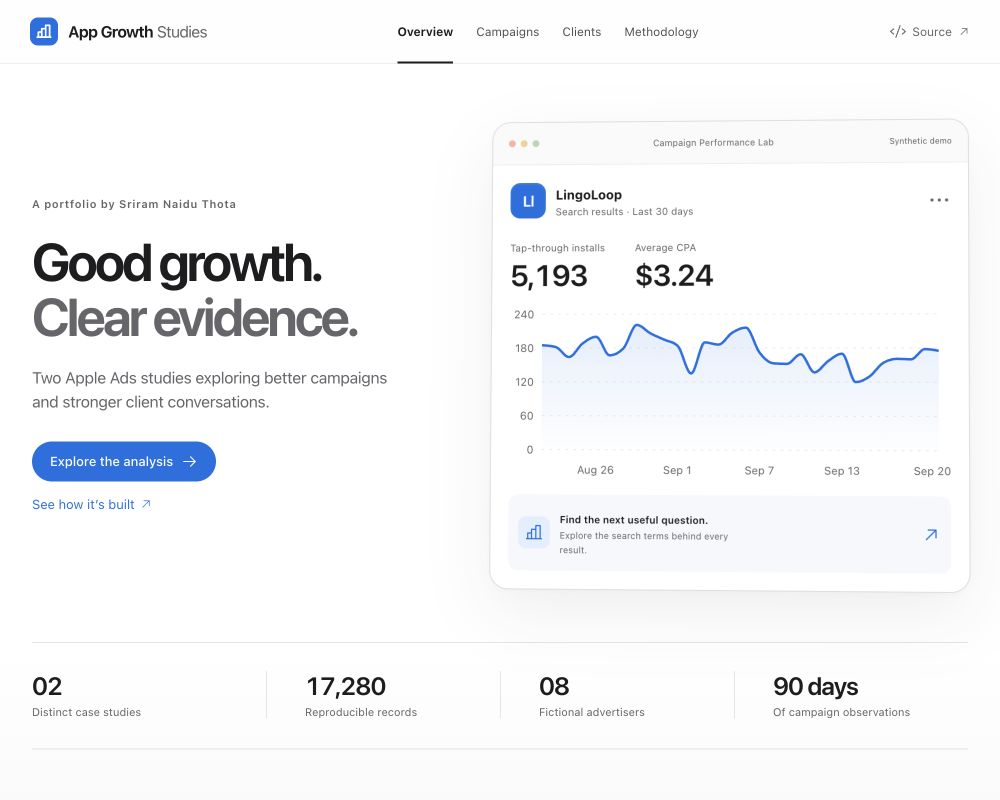

# App Growth Studies

Two independent Apple Ads portfolio case studies by **Sriram Naidu Thota**. Built for demonstrating campaign analysis, Excel reporting, client communication, and commercial judgment.

**[Live portfolio](https://sriram369.github.io/apple-ads/)** · [Campaign demo](https://sriram369.github.io/apple-ads/#/campaigns) · [Advertiser demo](https://sriram369.github.io/apple-ads/#/clients)

> All advertisers, account notes, targets, and performance data are fictional. This is an independent portfolio, not an Apple product or an account-management integration. Modeled outcomes are hypothetical; no live campaign lift is claimed.



## 01. Campaign Performance Lab

Investigate an app advertiser's acquisition performance using 90 days of campaign, keyword, and search-term observations. Filter by advertiser, region, period, and campaign theme. Review transparent recommendations and conversion uncertainty, export the filtered table, and explore a capped Competitor-to-Category spend transfer.

- Count-based TTR, CR, average CPT, and tap-through CPA.
- Separate new downloads, redownloads, and view-through installs.
- Evidence dialogs with next steps, limitations, and Wilson conversion intervals.
- A sensitivity model that conserves total spend and exposes marginal acquisition-cost assumptions.
- An Excel workbook with live `SUMIFS`, source records, and editable scenario inputs.

**[Excel workbook](public/downloads/campaign-analysis.xlsx)** · **[Optimization brief](public/downloads/campaign-optimization-brief.pdf)**

The downloadable workbook and brief focus on LingoLoop. The interactive screen can analyze all eight fictional accounts; its CSV export follows the active filters.

## 02. Advertiser Growth & Client Review

Prioritize eight fictional advertiser accounts by acquisition efficiency, trends, and client context. Compare equivalent 30-day periods, inspect the reason behind each recommendation, and open a five-slide review with a 30-day action plan. The Stride case shows why low installation CPA does not resolve a client concern about subscriber quality.

- Search and filter accounts by owner and next step.
- Explainable triage with a quality concern taking precedence over expansion.
- Five-slide client reviews for every account; printable as PDF.
- Downloadable Markdown briefs and an Excel account-analysis workbook.

**[Excel workbook](public/downloads/client-growth.xlsx)** · **[Five-page Stride review](public/downloads/stride-client-review.pdf)**

## Run locally

Requires Node.js 22.12+ or 24 and Python 3.10+.

```bash
npm ci
npm run dev
```

Open the printed URL ending in `/apple-ads/`. The app uses hash routes so direct demo links work on GitHub Pages.

```bash
npm test
npm run check:data
npm run build
```

## Reproduce the data

```bash
python3 analysis/generate.py
```

The standard-library generator uses seed `369` and produces **17,280 records** across eight accounts, US and GB storefronts, four campaign themes, and 90 days from June 23 to September 20, 2026. All account currency is USD, including GB observations. The as-of date is October 20, 2026.

`analysis/queries.sql` independently calculates the latest 30-day account totals in SQLite. Python integrity tests validate uniqueness, funnel bounds, bid ceilings, and SQL reconciliation. TypeScript tests validate weighted metrics, undefined denominators, decision boundaries, quality concerns, scenario conservation, and CSV escaping.

`analysis/build-reports.py` regenerates the PDF reports using ReportLab. `analysis/build-workbooks.mjs` authors the Excel files through `@oai/artifact-tool` in the Codex bundled runtime, selected with `ARTIFACT_NODE_MODULES`. Spreadsheet files are checked in so a normal website build does not require that authoring runtime. They contain editable formulas and original/prepared source tables; opening them in Excel does not require Codex. They use formula summaries rather than native PivotTables.

After changing source data or assumptions, regenerate the workbooks and PDFs before publishing. The website derives its metrics directly from `public/data/portfolio.json`.

## Repository

| Path | Purpose |
| --- | --- |
| `src/analytics.ts` | Metric definitions, recommendations, account priority, uncertainty, and scenario logic |
| `src/Campaigns.tsx` | Campaign workbench and evidence dialogs |
| `src/Clients.tsx` | Advertiser portfolio and five-slide reviews |
| `src/Methodology.tsx` | Sources, assumptions, definitions, and limitations |
| `analysis/` | Deterministic generator, SQL, tests, and artifact builders |
| `public/data/` | Browser dataset and independently computed SQL summaries |
| `public/downloads/` | Excel, PDF, and CSV artifacts |
| `docs/` | Case-study narratives, data dictionary, and verification notes |

## Deployment

GitHub Actions installs dependencies, regenerates and checks source data, runs tests, builds the website, and publishes `dist/` to GitHub Pages on pushes to `main`. Pull requests run the same checks without deploying. No backend, API key, live Apple account, analytics tracker, or visitor login is required.

The UI uses the operating system's installed interface font through CSS. No Apple font files, logos, or proprietary UI assets are redistributed.

## Definitions and limitations

- [Apple Ads glossary](https://ads.apple.com/app-store/help-glossary)
- [Reporting definitions](https://ads.apple.com/app-store/help/reporting/0023-reporting-options-and-definitions)
- [Campaign structure](https://ads.apple.com/app-store/best-practices/campaign-structure)

Metric definitions were reviewed October 20, 2026. Recommendation cutoffs are independently designed teaching heuristics, not official Apple rules or industry benchmarks. Synthetic attribution is disjoint by construction. Attribution is not incrementality; install efficiency is not evidence of retention, revenue, or profitability. See the live Methodology page and [data dictionary](docs/DATA_DICTIONARY.md).

## Author

[Sriram Naidu Thota](https://www.linkedin.com/in/sriramthota) · [Portfolio](https://sriram369.github.io) · [Email](mailto:sriramthota@outlook.com)
